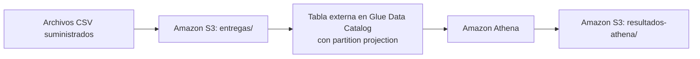

# Intentos de entrega en Athena con partition projection

Consulta de los archivos diarios de intentos de entrega de una empresa de mensajería mediante **Amazon S3**, **AWS Glue Data Catalog** y **Amazon Athena**. La tabla usa **partition projection** por fecha, de modo que nuevas fechas dentro del rango configurado se pueden consultar sin crawlers ni registro manual de particiones.



## Estructura del repositorio

```text
.
├── README.md
├── .gitignore
├── data/entregas/                 # CSV de entrada suministrados (no modificar)
├── resultados_esperados/          # Referencias suministradas (no subir a S3)
├── infraestructura/
│   ├── principal.tf               # Proveedor y recursos (S3, Glue, Athena)
│   ├── variables.tf               # Variables con valores por defecto
│   └── salidas.tf                 # Outputs que identifican los recursos
├── consultas/                     # SQL de las demostraciones
├── resultados/
│   ├── inicial/                   # Resultados de Athena con los días 1 y 2
│   └── final/                     # Resultados de Athena con los días 1, 2 y 3
├── evidencias/                    # Salidas de Terraform y registro de ejecuciones
└── respuestas.md                  # Preguntas conceptuales
```

## 1. Prerrequisitos

| Herramienta | Versión utilizada | Comprobación |
| --- | --- | --- |
| Terraform | 1.16.4 (mínimo 1.5.0) | `terraform -version` |
| Proveedor AWS de Terraform | 6.73.0 (`~> 6.0`, fijado en `.terraform.lock.hcl`) | `terraform providers` |
| AWS CLI | 2.36.50 | `aws --version` |
| Git | cualquiera reciente | `git --version` |

- Cuenta de AWS con un usuario IAM con permisos sobre **S3**, **Glue** y **Athena** (crear, leer y eliminar recursos).
- Credenciales configuradas con `aws configure` (perfil `default`). Para verificarlas:

  ```bash
  aws sts get-caller-identity
  ```

> **Nota de red (IPv6).** Durante `terraform init` la descarga del proveedor AWS falló con `read: no route to host` sobre una dirección IPv6. Si ocurre, se puede desactivar IPv6 temporalmente y volver a activarlo al terminar:
>
> ```bash
> sudo networksetup -setv6off Wi-Fi
> terraform init
> sudo networksetup -setv6automatic Wi-Fi
> ```
>
> Alternativamente, se puede descargar el proveedor con `curl -4` y ubicarlo en la caché de plugins de Terraform (`~/.terraform.d/plugin-cache`).

## 2. Región y configuración

- **Región:** `us-east-1`.
- Todas las variables tienen valores por defecto en `infraestructura/variables.tf`, por lo que no se requiere un archivo `.tfvars`.

| Variable | Valor por defecto | Descripción |
| --- | --- | --- |
| `region` | `us-east-1` | Región de despliegue |
| `nombre_bucket` | `entregas-mensajeria-victor-2026` | Bucket S3 privado del ejercicio |
| `nombre_base_datos` | `mensajeria_db` | Base de datos de Glue Data Catalog |
| `nombre_tabla` | `entregas` | Tabla externa |
| `nombre_workgroup` | `wg-mensajeria` | Workgroup de Athena |
| `fecha_inicio_proyeccion` | `2026-10-01` | Primera fecha proyectada (incluida) |
| `fecha_fin_proyeccion` | `2026-10-03` | Última fecha proyectada (incluida) |

El nombre del bucket debe ser único en todo AWS. Para reproducir el ejercicio con otro nombre, primero se comprueba que esté libre (debe responder `404 Not Found`) y luego se pasa como variable:

```bash
aws s3api head-bucket --bucket <otro-nombre>
terraform apply -var="nombre_bucket=<otro-nombre>"
```

### Recursos creados

| Recurso | Configuración principal |
| --- | --- |
| Bucket S3 | Privado, con bloqueo de acceso público (las 4 opciones activas). Prefijos `entregas/` (datos) y `resultados-athena/` (resultados). |
| Base de datos Glue | `mensajeria_db` |
| Tabla externa Glue | CSV separado por coma (`LazySimpleSerDe`), omite el encabezado (`skip.header.line.count = 1`). Columnas `id_envio string`, `ciudad string`, `transportadora string`, `estado string`, `duracion_minutos int`. Clave de partición `fecha string`. |
| Partition projection | `projection.fecha.type = date`, formato `yyyy-MM-dd`, rango `2026-10-01,2026-10-03`, intervalo `1` `DAYS`, plantilla `s3://<bucket>/entregas/fecha=${fecha}/` |
| Workgroup Athena | `wg-mensajeria`, resultados en `s3://<bucket>/resultados-athena/`, configuración del workgroup obligatoria |

## 3. Despliegue

Desde la raíz del repositorio:

```bash
cd infraestructura
terraform init
terraform fmt
terraform validate
terraform plan
terraform apply -no-color -auto-approve | tee ../evidencias/aplicacion_terraform.txt
terraform output -json > ../evidencias/outputs.json
cd ..
```

Resultado esperado:

- `terraform validate` → `Success! The configuration is valid.`
- `terraform plan` → `Plan: 5 to add, 0 to change, 0 to destroy.`
- `terraform apply` → `Apply complete! Resources: 5 added, 0 changed, 0 destroyed.`

Evidencias generadas:

- `evidencias/aplicacion_terraform.txt`: salida completa de `terraform apply`.
- `evidencias/outputs.json`: identificadores del bucket, la base de datos, la tabla y el workgroup.

## 4. Carga de archivos

Los archivos de entrada (`data/`) y las referencias (`resultados_esperados/`) se conservan en la carpeta padre, junto a `repositorio/`. Todos los comandos se ejecutan desde `repositorio/`.

```bash
BUCKET=$(terraform -chdir=infraestructura output -raw bucket_nombre)
```

### Etapa 1: días 1 y 2

Se cargan **únicamente** los dos primeros archivos, uno por comando (sin carga recursiva):

```bash
aws s3 cp "../data/entregas/fecha=2026-10-01/entregas.csv" "s3://$BUCKET/entregas/fecha=2026-10-01/entregas.csv"
aws s3 cp "../data/entregas/fecha=2026-10-02/entregas.csv" "s3://$BUCKET/entregas/fecha=2026-10-02/entregas.csv"
aws s3 ls s3://$BUCKET/entregas/ --recursive | tee evidencias/carga_inicial_s3.txt
```

El archivo del 3 de octubre se conserva localmente hasta la etapa 2. Una consulta `SELECT COUNT(*) FROM entregas` devuelve **12**, aunque el rango proyectado ya incluye el 3 de octubre.

## 5. Ejecución de consultas (etapa inicial)

Las consultas están en `consultas/` y se ejecutan en el workgroup `wg-mensajeria` sobre la base `mensajeria_db`. Para no repetir pasos se usa el script `ejecutar.sh`, que:

1. Lanza la consulta con `aws athena start-query-execution`.
2. Espera hasta que su estado sea `SUCCEEDED`.
3. Descarga el resultado desde `s3://<bucket>/resultados-athena/<id_ejecucion>.csv`.
4. Registra la etapa, el SQL, el identificador y el resultado en `evidencias/ejecuciones_athena.csv`.

```bash
bash ./ejecutar.sh inicial consultas/intentos_por_fecha_estado.sql resultados/inicial/intentos_por_fecha_estado.csv
bash ./ejecutar.sh inicial consultas/porcentaje_exito_por_fecha_ciudad.sql resultados/inicial/porcentaje_exito_por_fecha_ciudad.csv
bash ./ejecutar.sh inicial consultas/duracion_promedio_2026-10-02.sql resultados/inicial/duracion_promedio_2026-10-02.csv
```

| Consulta | Detalle |
| --- | --- |
| `intentos_por_fecha_estado.sql` | `COUNT(*)` por fecha y estado, ordenado por fecha y estado. Sin filtro de fechas: el rango de proyección limita las fechas consultables. |
| `porcentaje_exito_por_fecha_ciudad.sql` | `100 × entregados / total de intentos` por fecha y ciudad. Se usa `DOUBLE` para evitar la división entera y `DECIMAL(5,2)` para presentar dos decimales. |
| `duracion_promedio_2026-10-02.sql` | `AVG(duracion_minutos)` solo con `estado = 'entregado'` para el 2026-10-02, con dos decimales. |

### Comparación con las referencias

Athena entrega los valores entre comillas, así que se eliminan antes de comparar:

```bash
for f in intentos_por_fecha_estado porcentaje_exito_por_fecha_ciudad; do
  diff <(tr -d '"' < resultados/inicial/$f.csv) ../resultados_esperados/${f}_inicial.csv && echo "OK $f"
done
diff <(tr -d '"' < resultados/inicial/duracion_promedio_2026-10-02.csv) ../resultados_esperados/duracion_promedio_2026-10-02.csv && echo "OK duracion"
```

Los tres resultados coinciden con las referencias (6 filas de intentos, 4 de porcentajes y 1 de duración).

## 6. Incorporación del día 3 (etapa final)

Sin modificar la infraestructura ni las propiedades de la tabla, se carga **solo** el archivo del 3 de octubre. No se ejecutan crawlers, `MSCK REPAIR TABLE`, `ALTER TABLE ADD PARTITION` ni `terraform apply`.

```bash
BUCKET=$(terraform -chdir=infraestructura output -raw bucket_nombre)
aws s3 cp "../data/entregas/fecha=2026-10-03/entregas.csv" "s3://$BUCKET/entregas/fecha=2026-10-03/entregas.csv"
aws s3 ls s3://$BUCKET/entregas/ --recursive | tee evidencias/carga_final_s3.txt
```

### Verificación

`consultas/verificacion_tercer_dia.sql` contiene cuatro sentencias. Athena ejecuta una sentencia por ejecución, así que se lanzan por separado indicando su número:

```bash
bash ./ejecutar.sh final consultas/verificacion_tercer_dia.sql resultados/final/verificacion_tercer_dia.csv 1
bash ./ejecutar.sh final consultas/verificacion_tercer_dia.sql resultados/final/registros_por_fecha.csv 2
bash ./ejecutar.sh final consultas/verificacion_tercer_dia.sql resultados/final/total_registros.csv 3
bash ./ejecutar.sh final consultas/verificacion_tercer_dia.sql resultados/final/conteo_estado_tercer_dia.csv 4
```

| Sentencia | Resultado | Valor obtenido |
| --- | --- | --- |
| 1 | `resultados/final/verificacion_tercer_dia.csv` | 6 registros del 2026-10-03 (ENV-013 a ENV-018) |
| 2 | `resultados/final/registros_por_fecha.csv` | 6 registros por cada fecha |
| 3 | `resultados/final/total_registros.csv` | 18 registros en total |
| 4 | `resultados/final/conteo_estado_tercer_dia.csv` | 2 `entregado`, 3 `destinatario_ausente`, 1 `direccion_incorrecta` |

### Consultas agregadas sobre los tres días

Las consultas no tienen filtro de fechas, así que se ejecutan sin cambios:

```bash
bash ./ejecutar.sh final consultas/intentos_por_fecha_estado.sql resultados/final/intentos_por_fecha_estado.csv
bash ./ejecutar.sh final consultas/porcentaje_exito_por_fecha_ciudad.sql resultados/final/porcentaje_exito_por_fecha_ciudad.csv

for f in intentos_por_fecha_estado porcentaje_exito_por_fecha_ciudad; do
  diff <(tr -d '"' < resultados/final/$f.csv) ../resultados_esperados/${f}_final.csv && echo "OK $f"
done
```

Ambos resultados coinciden con las referencias finales (9 filas de intentos y 6 de porcentajes). Todas las ejecuciones quedan registradas con la etapa `final` en `evidencias/ejecuciones_athena.csv`.

## 7. Limpieza

Antes de limpiar se guardaron y subieron al repositorio todas las evidencias. Desde `repositorio/`:

```bash
BUCKET=$(terraform -chdir=infraestructura output -raw bucket_nombre)

# 1. Vaciar el bucket (datos de entregas/ y resultados de resultados-athena/)
aws s3 rm s3://$BUCKET --recursive

# 2. Eliminar todos los recursos del ejercicio con Terraform
terraform -chdir=infraestructura destroy -no-color -auto-approve | tee evidencias/eliminacion_terraform.txt
```

Resultado: `Destroy complete! Resources: 5 destroyed.` (bucket, bloqueo de acceso público, base de datos de Glue, tabla y workgroup de Athena). El workgroup se elimina junto con su historial gracias a `force_destroy = true`.

Evidencias:

- `evidencias/eliminacion_terraform.txt`: salida de `terraform destroy`.
- `evidencias/verificacion_eliminacion.txt`: comprobación de que el bucket, la base de datos y el workgroup ya no existen.

## Seguridad

El archivo `.gitignore` excluye credenciales, archivos de estado de Terraform (`*.tfstate`, `*.tfstate.*`), archivos de variables (`*.tfvars`) y la carpeta local `.terraform/`. Ninguno de ellos forma parte de la entrega.
